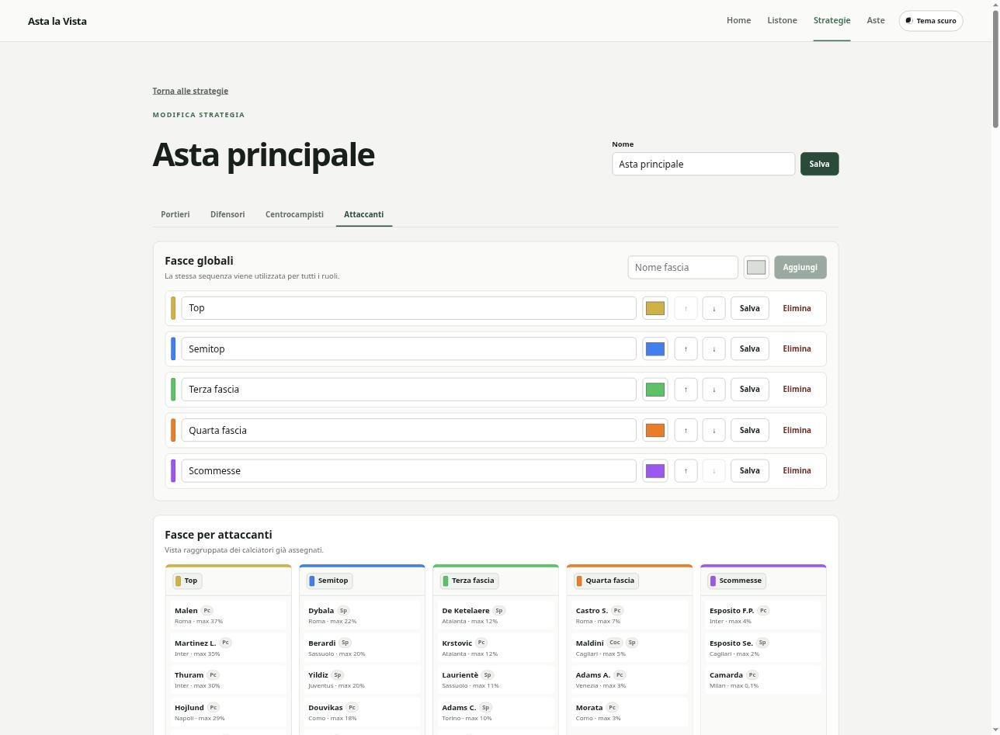
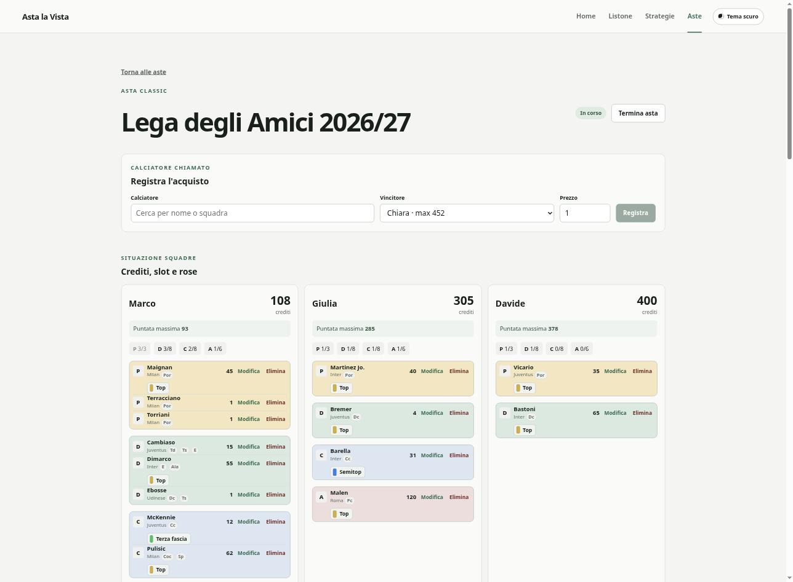
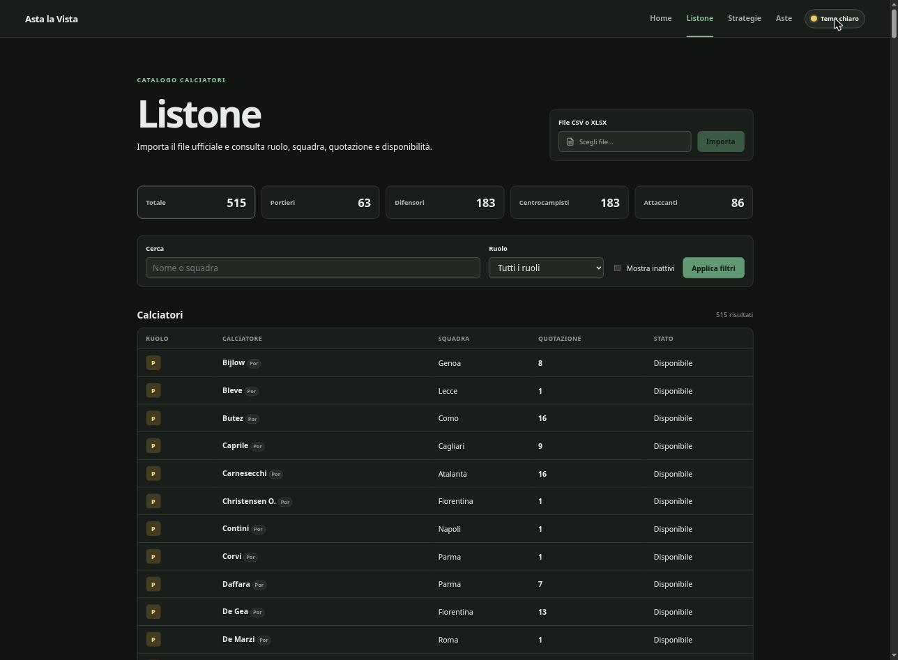

# Asta la Vista

[](https://github.com/fedeRizzi04/asta-la-vista/actions/workflows/backend.yml)
[](https://github.com/fedeRizzi04/asta-la-vista/releases/latest)
[](LICENSE)
[](backend/pyproject.toml)
[](frontend/package.json)
[](frontend/package.json)

Asta la Vista is a web app that assists you during a fantacalcio (Italian fantasy football)
auction. For now only the Classic mode is supported. Upload a player list in _.csv_ or _.xlsx_
format, with each player's role and team, and run the whole auction from there: no more
spreadsheets, or pen and paper.

The user interface is in Italian.

## Features

- **Player list (Listone)**: import the official fantacalcio.it file and keep track of every
  player's role, team, price and availability.
- **Strategies**: create custom global tiers (colour, order, maximum spending percentage) and
  assign each role's players to them, so you always know at a glance whom to buy and for how much.
- **Live auctions**: follow every participant's remaining credits, free slots and squad in real
  time while you record purchases. Your tiers stay visible, so you can see who has already been
  taken. A 360-degree view of each role shows the players already bought and those still
  available to call.
- **Final report**: when the auction ends, download an HTML summary. It opens in any browser,
  with no server or internet connection.

<p align="center">
  
  
</p>

There is also a dark theme, for auctions that run late into the night (we know a thing or two
about that):

<p align="center">
  
</p>

## Why

The project started as an experiment: building a whole application with a coding agent, guided
by careful planning. It also gives auctions a free, automated tool, instead of the usual sheet
of paper or spreadsheet (which sometimes isn't free either).

## Getting started

There are three ways to run Asta la Vista. They all run the same application.

| | Best for | You need |
|---|---|---|
| [Desktop app](#desktop-app) | Anyone: download and double-click | Windows 10/11 (64-bit) or a Mac with Apple Silicon |
| [Docker](#docker) | Running it in a container, or on a home server | Docker with the Compose plugin |
| [From source](#from-source) | Development | Python 3.12+, uv and Node.js 24+ |

### Desktop app

Download the latest version from the
[**Releases page**](https://github.com/fedeRizzi04/asta-la-vista/releases/latest):

- **Windows**: `AstaLaVista-<version>-windows.exe`
- **macOS (Apple Silicon)**: `AstaLaVista-<version>-macos.zip`

The app starts a small local server on your computer and opens Asta la Vista in your default
browser. Nothing is sent over the internet: your data stays on your computer.

The app is free and is not signed with a paid Apple or Microsoft developer certificate, so your
computer warns you the first time you open it. This is expected. You only need to allow it once.

#### Windows

1. Your browser may say the file "isn't commonly downloaded". Choose **Keep** (in Edge: **⋯ →
   Keep → Show more → Keep anyway**).
2. Move `AstaLaVista-<version>-windows.exe` somewhere convenient, for example your Desktop or
   your Documents folder.
3. Double-click it. If you see **"Windows protected your PC"**, click **More info**, then
   **Run anyway**.

Opening the app takes a few seconds, because Windows unpacks the program each time it starts.

#### macOS

1. Double-click the downloaded `.zip` to extract **Asta la Vista**, then drag it into your
   **Applications** folder.
2. Open it. macOS will say it cannot verify the app: click **Done** (do not move it to the
   Trash).
3. Open **System Settings → Privacy & Security**, scroll down to the message about
   "Asta la Vista", and click **Open Anyway**. Confirm with your password.

If you are comfortable with the Terminal, this command does the same as steps 2–3:

```bash
xattr -dr com.apple.quarantine "/Applications/Asta la Vista.app"
```

#### Using the app

- Asta la Vista has **no window of its own**: it opens in a browser tab. Closing the tab does
  **not** stop it.
- To open it again or to quit it, use its icon: in the **menu bar** at the top of the screen on
  macOS, or in the **system tray** (next to the clock) on Windows. You may need to click the
  **^** arrow to see it there.
  - **Apri Asta la Vista** opens the app in the browser.
  - **Apri cartella dati** opens the folder that holds your data.
  - **Esci** quits the app.
- On Windows, opening the app again while it is already running just opens a new tab. On macOS,
  use the menu bar icon.
- The version you are running is shown at the bottom of every page.

#### Your data

Your auctions, strategies and player lists are saved in a database file in this folder:

| System | Folder |
|---|---|
| macOS | `~/Library/Application Support/Asta la Vista` |
| Windows | `%APPDATA%\Asta la Vista` |

The folder contains:

- `asta-la-vista.sqlite3`: the database;
- `asta-la-vista.log`: a log file, useful when reporting a problem;
- `instance.json` and `instance.lock`: small files that stop the app from being started twice.

To back up your data, quit the app and copy the folder.

#### Updating

When a new version is published, a banner at the top of the page tells you, with a link to its
download page. If you close the banner, it stays hidden until the next version comes out. To
find out, the app asks GitHub for the latest release at most every few hours. Nothing about you
or your auctions is sent, and when you are offline the app simply skips the check.

To update, download the new version and replace the old app with it. Your data is kept: the new
version updates the database automatically the first time it starts. What changed in each
version is listed in the [changelog](CHANGELOG.md).

### Docker

You need Docker with the Compose plugin. From the project root, run:

```bash
docker compose up --build
```

On the first start, Docker builds the image, creates the database and applies the migrations.
When the application is ready, open `http://localhost:5000`. Later you can start it with just
`docker compose up`. After you update the project, add `--build` again to rebuild the image.

To use a different port, for example `8080`:

```bash
HOST_PORT=8080 docker compose up
```

The SQLite database is stored in the Docker volume `app-data`, so auctions and strategies survive
`docker compose down` and image rebuilds. To delete them too, see [Uninstalling](#docker-1).

To be told when a new version is available, as the desktop app does, start it with:

```bash
UPDATE_CHECK=true docker compose up
```

### From source

You need:

- Python 3.12 or later
- [uv](https://docs.astral.sh/uv/)
- Node.js 24 or later

After cloning the repository, install the backend and create the local configuration:

```bash
cd backend
cp .env.example .env
uv sync
uv run alembic upgrade head
```

Then install the frontend:

```bash
cd ../frontend
npm install
```

The SQLite database is saved in the local folder `backend/instance`, which Git ignores.

After this first setup, you can prepare and start the whole application from the project root
with:

```bash
./bin/start
```

The script applies the migrations, re-syncs the dependencies whenever the lockfiles change, and
starts the backend and the frontend. The `APP_HOST` and `APP_PORT` settings in `backend/.env`
are used by both the local server and the frontend proxy. Set `UPDATE_CHECK=true` in the same
file to see the new-version banner. Do not run the script with `sudo`: the configuration and the
database must belong to your user.

#### Starting the backend manually

```bash
cd backend
uv run flask --app asta_la_vista.entrypoints.flask_app:create_app run --host 127.0.0.1
```

The backend answers on `http://127.0.0.1:5000`. The health check is at
`http://127.0.0.1:5000/api/health`.

#### Starting the frontend manually

In a second terminal:

```bash
cd frontend
npm run dev
```

The interface is available at `http://127.0.0.1:5173`. During development, requests to `/api`
are forwarded to the Flask backend.

#### Building the desktop app yourself

You can build the desktop app for the system you are on (macOS builds the `.app`, Windows the
`.exe`) with:

```bash
./bin/build-desktop
```

The result is in `dist/desktop/`. On macOS, open it with
`open "dist/desktop/Asta la Vista.app"`. To check a build automatically, run:

```bash
./bin/smoke-test-desktop "dist/desktop/Asta la Vista.app/Contents/MacOS/AstaLaVista"
```

The smoke test starts the app with a temporary data folder, checks the API and the frontend,
stops the app and deletes the temporary folder.

You can also run the desktop launcher without building it:

```bash
cd backend
uv run --group desktop python -m asta_la_vista.entrypoints.desktop
```

Both the build and this command use the same data folder as the downloaded app (see
[Your data](#your-data)). To keep test data separate, set `ASTA_LA_VISTA_DATA_DIR` to another
folder before starting it.

## Preparing the player list

Before your first auction, Asta la Vista needs the list of players (the _listone_). You get it
from fantacalcio.it and import it once. You can import it again whenever it changes.

### Downloading the file

1. Log in to fantacalcio.it, then open the
   [quotations page](https://www.fantacalcio.it/quotazioni-fantacalcio). It shows the current
   season by default; the season selector lets you pick another one.
2. Click **Scarica**. This downloads the file, named like
   `Quotazioni_Fantacalcio_Stagione_2026_27.xlsx`. Do not edit it.

### Importing it

1. Open the **Listone** section of the app.
2. Choose the file and click **Importa**.
3. A message tells you how many players were added, updated or deactivated, and how many changed
   role. The counts per role are shown right below it, so you can check them at a glance.

### Importing it again

You can import a newer file at any time, for example when quotations or teams change after the
transfer market. Players are matched by their `Id`, so nothing already set up is lost:

- new players are added, and existing ones get their name, team, role and quotation updated;
- players missing from the new file are **deactivated**, not deleted. They disappear from the
  list, unless you tick **Mostra inattivi**;
- if a player changed role, the strategies that contain them follow the new role;
- if an auction is in progress, the app asks you to confirm before importing.

### Using another file

The app also accepts a _.csv_ file, or an _.xlsx_ file you built yourself, as long as it follows
the same layout as the official one:

- an _.xlsx_ file needs a sheet named `Tutti`;
- the header row must have the columns `Id`, `R` (role: `P`, `D`, `C` or `A`), `Nome` and
  `Squadra`. It can be among the first 10 rows, because the official file starts with a title;
- `Qt.A` (the current quotation, a whole number) and `RM` (the Mantra roles, separated by `;`)
  are optional;
- a _.csv_ file must be UTF-8, with `,` or `;` as separator;
- every `Id` must be unique, and no row can have an empty `Id`, `R`, `Nome` or `Squadra`.

If something is wrong with the file, the app tells you what instead of importing part of it.

## Uninstalling

Follow the section that matches how you used Asta la Vista. If you used more than one method,
follow each of them.

### Desktop app

1. **Quit the app**: click its icon in the menu bar or system tray, then **Esci**.
2. **Delete the app**:
   - macOS: drag **Asta la Vista** from **Applications** to the Trash, then empty the Trash. Also
     delete the downloaded `.zip`.
   - Windows: delete `AstaLaVista-<version>-windows.exe`.
3. **Delete your data** (database, log and instance files). This cannot be undone, so back up
   the folder first if you might want your auctions later.
   - macOS: in Finder, choose **Go → Go to Folder…**, type
     `~/Library/Application Support`, and move the **Asta la Vista** folder to the Trash. Or, in
     the Terminal:

     ```bash
     rm -rf ~/Library/Application\ Support/Asta\ la\ Vista
     ```

   - Windows: press **Win + R**, type `%APPDATA%`, press Enter, and delete the
     **Asta la Vista** folder. Or, in PowerShell:

     ```powershell
     Remove-Item -Recurse -Force "$env:APPDATA\Asta la Vista"
     ```

Asta la Vista writes nothing else on your computer, with two small exceptions:

- your browser remembers the theme you chose for the site `127.0.0.1`; clearing your browser's
  site data removes it;
- if the Windows app ever crashed, Windows may have left a folder named `_MEI` followed by
  numbers in `%TEMP%`; you can delete it.

### Built from source

The local builds and the desktop launcher store their data in the same folder as the downloaded
app, so start with steps 1 and 3 of [Desktop app](#desktop-app-1). If you set
`ASTA_LA_VISTA_DATA_DIR`, delete that folder as well. If you copied the built `.app` into
**Applications**, delete it there too.

Then, everything else lives inside the cloned repository:

| Path | Contents |
|---|---|
| `backend/instance/` | database used by `./bin/start` and the manual backend |
| `backend/.env` | local configuration |
| `backend/.venv/` | Python dependencies |
| `frontend/node_modules/`, `frontend/.svelte-kit/`, `frontend/build/` | frontend dependencies and builds |
| `dist/`, `build/` | desktop app builds |

Deleting the repository folder removes all of them. To keep the code but free the space, run
this from the project root:

```bash
rm -rf backend/instance backend/.env backend/.venv \
  frontend/node_modules frontend/.svelte-kit frontend/build dist build
```

The tools also keep caches outside the repository. Other projects may use these caches too, so
removing them is optional:

| Tool | Cache | How to remove it |
|---|---|---|
| PyInstaller | macOS: `~/Library/Application Support/pyinstaller`; Windows: `%LOCALAPPDATA%\pyinstaller` | delete the folder |
| uv | downloaded packages | `uv cache clean` |
| npm | downloaded packages | `npm cache clean --force` |

### Docker

From the project root, run:

```bash
docker compose down --volumes --rmi local
```

This removes the container, the `app-data` volume with the database, and the image that Compose
built. To also free the space used by the base images and the build cache, run:

```bash
docker image rm node:24-alpine python:3.12-slim ghcr.io/astral-sh/uv:0.11.21
docker builder prune
```

Finally, delete the repository folder.

## How the app works

The backend is a Flask application that serves the JSON API under `/api` and the compiled
SvelteKit frontend. Data is stored in SQLite, and the database schema is managed with Alembic
migrations. The three ways of running it differ only in what surrounds that application:

| | Server | Database | Frontend |
|---|---|---|---|
| From source (`bin/start`) | Flask development server | `backend/instance/` | Vite development server, port 5173 |
| Docker | gunicorn | `app-data` volume | build served by Flask |
| Desktop | waitress, on `127.0.0.1` only | your user data folder | build bundled in the executable, served by Flask |

The desktop app is built with [PyInstaller](https://pyinstaller.org/), which packages Python,
the backend, the migrations and the compiled frontend into a single executable. When it starts,
it:

1. makes sure it is the only copy running; if another copy is running, it opens the browser on
   that copy and exits;
2. applies any pending migrations to the database in your data folder;
3. starts the server on port 47615, or on any free port if 47615 is taken;
4. opens your browser and shows the menu bar or tray icon until you quit.

The desktop app also turns on the update check (`UPDATE_CHECK`). `GET /api/version` then adds
the latest release on GitHub to its answer, and the frontend shows the banner when that release
is newer. GitHub is asked in the background, at most every 6 hours (every minute after a failure,
such as being offline), and an API request waits for it at most 2 seconds. When the answer comes
later, the page still gets it: it asks again after a few seconds, every 15 minutes, when you come
back to the tab and when the computer goes back online. The code is in
`backend/src/asta_la_vista/adapters/releases.py` and `frontend/src/lib/versionWatcher.ts`.

The code is in `backend/src/asta_la_vista/entrypoints/desktop/`, and the build recipe is in
`desktop/asta-la-vista.spec`.

## Application flow

1. Open the Listone section and import the CSV or XLSX file with the players. The file from
   [fantacalcio.it](https://www.fantacalcio.it/quotazioni-fantacalcio) works best: see
   [Preparing the player list](#preparing-the-player-list).
2. Create one or more strategies: define global tiers with their own order and colours, and
   assign players to the tiers for each role. For each player you can optionally add a note and
   a maximum spending percentage. During the auction, the percentage is converted into credits
   using the auction's starting budget.
3. Create the auction, with credits, slots, participants and, optionally, a strategy.
4. Start the auction and record each purchase. The screen updates every participant's remaining
   credits, maximum bid, slots and squad. The player panel lets you filter by role, sort by tier
   or price, and pick the next player to call.
5. When the auction ends, download the report in HTML format. It opens in any browser.

## Releasing a new version

The version number lives in one place: `version` in `backend/pyproject.toml`. The app reads it
at runtime and shows it in the page footer.

While you work, describe each user-visible change under `## [Unreleased]` in
[CHANGELOG.md](CHANGELOG.md). To release, turn that heading into the new version and date
(for example `## [0.2.0] - 2026-11-20`), add an empty `## [Unreleased]` above it, update the
links at the bottom of the file, then:

```bash
./bin/release-notes 0.2.0  # preview the release notes
cd backend
uv version --bump minor   # or patch / major: updates pyproject.toml and uv.lock
cd ..
git commit -am "release 0.2.0"
git tag v0.2.0
git push origin main v0.2.0
```

Pushing the tag starts the [Release workflow](.github/workflows/release.yml). It:

1. checks that the tag matches the version in `pyproject.toml`, and that `CHANGELOG.md` has a
   section for it;
2. builds the app on Windows and on macOS;
3. smoke-tests each build;
4. publishes a GitHub Release with both files, using that `CHANGELOG.md` section as its notes.

Once it is published, the desktop apps already installed show the new-version banner.

The users' databases must survive every update, so:

- never modify a migration that has already been released: add a new one instead;
- make sure every migration works on existing data, not just on an empty database.

## Checks

Run the backend tests:

```bash
cd backend
uv run --group desktop pytest
```

The desktop launcher tests need the `desktop` dependency group: without it they are skipped.

Check style and static errors:

```bash
uv run ruff check .
uv run ruff format --check .
```

Check the frontend:

```bash
cd frontend
npm run check
npm run lint
npm run build
```
